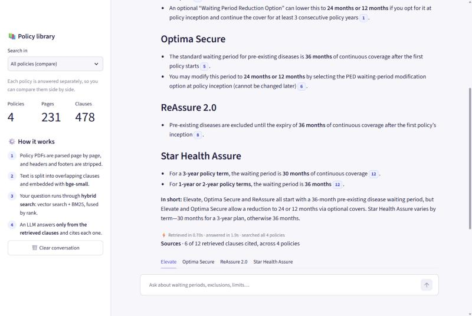
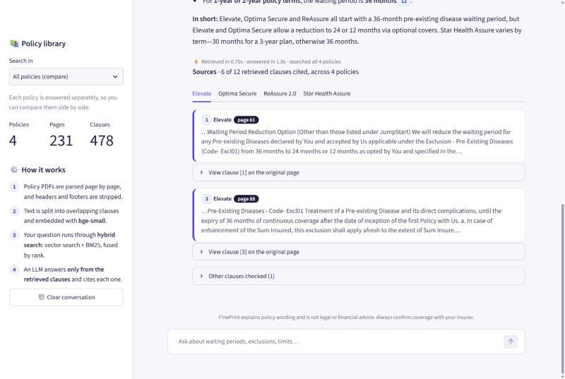
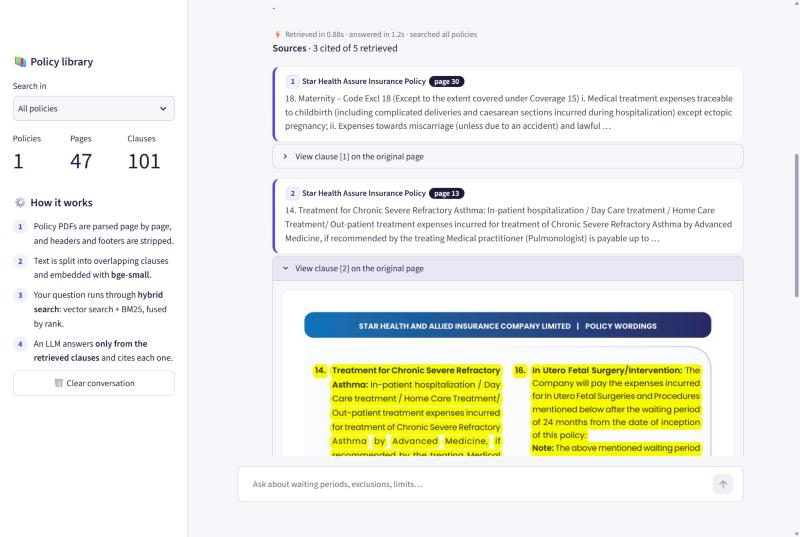
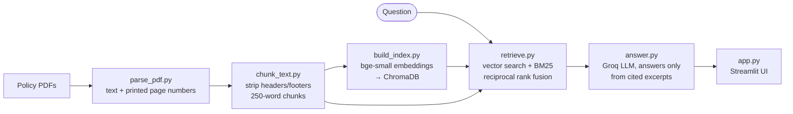

# FinePrint 📄

**Ask a question about your health insurance policy. Get a plain-language answer, with the exact clause and page it came from.**

Health insurance policy wordings run to 30–120 pages of dense legal text. The answers people actually need ("How long before my diabetes is covered?", "Is there a room rent cap?") are buried in exclusions, sub-limits and cross-references. FinePrint is a retrieval-augmented generation (RAG) assistant that finds the relevant clauses, answers **only** from them, cites every fact, and says so plainly when the policy doesn't cover the question.



## Features

- **Cited answers.** Every fact carries a citation badge linked to the source clause, its policy and its printed page number.
- **See the clause in the original PDF.** Any cited source can be opened as the real policy page with the clause highlighted.
- **Compare policies.** Ask once and get a separate answer for each policy, plus a one-line comparison.
- **Won't guess.** If the retrieved clauses don't answer the question, it says "The policy text provided doesn't cover this" instead of inventing an answer.
- **Hybrid search.** Combines meaning-based search with keyword search, so exact insurance terms like "AYUSH" or "Code-Excl02" are found as reliably as paraphrased questions.
- **Measured.** Retrieval quality is tracked with an evaluation set of questions whose answer pages were checked by hand.

| Sources, one tab per policy | Clause highlighted on the original page |
|---|---|
|  |  |

## How it works



1. **Parse** (`src/parse_pdf.py`): PyMuPDF extracts text page by page. It removes control characters, rejoins words hyphenated across lines, and detects the **page number printed on the page** (not the PDF index), because that's what a reader looks for.
2. **Chunk** (`src/chunk_text.py`): Lines that repeat on most pages (headers, footers, UIN codes) are removed. Each page is split into 250-word chunks with 50 words of overlap, tagged with insurer, plan and page.
3. **Index** (`src/build_index.py`): Chunks are embedded with [`BAAI/bge-small-en-v1.5`](https://huggingface.co/BAAI/bge-small-en-v1.5), which runs on a CPU, and stored in a persistent ChromaDB collection.
4. **Retrieve** (`src/retrieve.py`): Two searches run on each question, one by embedding similarity and one with BM25 keyword scoring. Their rankings are merged with reciprocal rank fusion (`1 / (60 + rank)`).
5. **Answer** (`src/answer.py`): The top clauses are numbered and sent to `openai/gpt-oss-120b` on Groq at temperature 0. The prompt allows only facts from those excerpts, with a citation for each.
6. **App** (`src/app.py`): A Streamlit chat interface with streaming answers, citation badges, source cards and highlighted PDF pages.

## Results

The evaluation set (`data/eval_questions.csv`) has 30 questions across 4 policies. For the 27 the policies answer, I found the answer page in the policy text by hand. The other 3 (car damage, pet cover, claim settlement ratio) aren't covered by any policy and are used to test refusals. A retrieval **hit** means a clause from the **right policy** and the **right page** is among the results.

| Mode | What's retrieved | Hit rate |
|---|---|---|
| One policy selected | Top 5 clauses from that policy | **27 / 27 (100%)** |
| All policies (compare) | Top 3 clauses from each policy | **26 / 27 (96%)** |
| One policy, strict | Only the single top clause | 19 / 27 (70%) |

The strict row shows where to improve: the right clause is usually found, but a related clause sometimes ranks above it (e.g. a page that only *mentions* the pre-existing disease waiting period). All 3 uncovered questions get the "doesn't cover this" response in both modes, never a made-up answer.

Reproduce with:

```bash
python src/evaluate.py      # top 5 per policy
python src/evaluate.py 1    # top 1 per policy
```

## Design decisions

**Hybrid search instead of embeddings alone.** Insurance wording relies on exact terms: "AYUSH", "pre-existing", exclusion codes like "Excl02". Embeddings match meaning well but can miss rare exact terms, and BM25 is the opposite. Fusing their *ranks*, rather than their raw scores (which use different scales), gets the strengths of both with no tuning.

**Printed page numbers, not PDF page numbers.** A cover page means PDF page 27 is printed as "26 / 46". Citing the wrong one sends the user to the wrong page. The parser reads both "26 / 46" footers and bare page numbers, and only accepts a number within 3 of the PDF page number, so table values like "100/ 200 Lakhs" aren't mistaken for one.

**Answering each policy separately in compare mode.** Searching all policies together scored only **59%**. The reason: "What is the waiting period for pre-existing diseases?" has a *different* correct answer in every policy, so the four policies' clauses competed for the same five slots. Retrieving the top clauses *per policy* and having the model answer under one heading per policy raised this to **96%**, and the answers can no longer mix up policies.

**Refusing when the policy is silent.** For insurance, a confident wrong answer ("yes, that's covered") can cost someone money. The model must answer only from the retrieved clauses and use a fixed "not covered" response otherwise, and the UI shows that response as a distinct card.

**Boilerplate removal that keeps list numbering.** Lines repeated on most pages are headers and footers, but short markers like "i." and "ii." also repeat. A minimum length of 10 characters keeps clause numbering intact, so answers can say "clause ii".

## Policies included

| Insurer | Plan | Pages |
|---|---|---|
| Star Health and Allied Insurance | Star Health Assure | 47 |
| Niva Bupa Health Insurance | ReAssure 2.0 | 34 |
| ICICI Lombard General Insurance | Elevate | 117 |
| HDFC ERGO General Insurance | Optima Secure | 33 |

The policy PDFs belong to their insurers and are **not included** in this repository. Download each policy wording from the insurer's website, save it in `data/raw_pdfs/` under the file name listed in `data/sources.csv`, and run the pipeline. Policy wordings are revised from time to time, so check the UIN printed in the PDF.

## Getting started

**Requirements:** Python 3.13 (tested on 3.13.7) and a free [Groq API key](https://console.groq.com/keys).

```bash
git clone https://github.com/YobinOmkarBangera/FinePrint-RAG.git
cd FinePrint-RAG
python -m venv venv
```

Activate the virtual environment (Windows PowerShell: `venv\Scripts\Activate.ps1`, macOS/Linux: `source venv/bin/activate`), then:

```bash
pip install -r requirements.txt
```

Create a `.env` file in the project root:

```
GROQ_API_KEY=your_key_here
```

Add the policy PDFs to `data/raw_pdfs/` (see [Policies included](#policies-included)), then build the index and start the app:

```bash
python src/parse_pdf.py      # PDFs  → data/processed/*.json
python src/chunk_text.py     # pages → data/processed/chunks.jsonl
python src/build_index.py    # chunks → data/index (ChromaDB)
streamlit run src/app.py
```

The first run downloads the embedding model (about 130 MB).

To add another policy, put its PDF in `data/raw_pdfs/`, add a row to `data/sources.csv`, and re-run the three pipeline scripts.

## Project structure

```
FinePrint-RAG/
├── data/
│   ├── sources.csv            # PDF file name → insurer, plan
│   ├── eval_questions.csv     # evaluation questions with verified pages
│   ├── raw_pdfs/              # policy PDFs (not committed)
│   ├── processed/             # parsed pages and chunks (generated)
│   └── index/                 # ChromaDB vector index (generated)
├── src/
│   ├── parse_pdf.py           # PDF → page text + printed page numbers
│   ├── chunk_text.py          # boilerplate removal + overlapping chunks
│   ├── build_index.py         # embeddings → ChromaDB
│   ├── retrieve.py            # hybrid search (vector + BM25 + RRF)
│   ├── answer.py              # prompt, citations, streaming, compare mode
│   ├── evaluate.py            # retrieval hit rate
│   └── app.py                 # Streamlit interface
├── docs/images/               # screenshots
└── requirements.txt
```

## Limitations and next steps

- **Answer accuracy isn't measured automatically yet.** The evaluation checks that the right clause is *retrieved*. The next step is scoring the final answers against expected facts (e.g. "36 months").
- **The evaluation set is small and was written by the author** with the PDFs open. Questions from real users would be phrased differently.
- **Scanned PDFs aren't supported.** Text-based PDFs only; the parser warns when a PDF looks scanned, but there's no OCR.
- **Chunks don't cross page boundaries.** This keeps page citations exact, but a clause that continues onto the next page is split in two.

## Tech stack

Python · PyMuPDF · sentence-transformers (bge-small-en-v1.5) · ChromaDB · rank-bm25 · Groq (gpt-oss-120b) · Streamlit

## Disclaimer

FinePrint explains policy wording. It is not legal or financial advice. Always confirm coverage with your insurer.

## License

[MIT](LICENSE)
